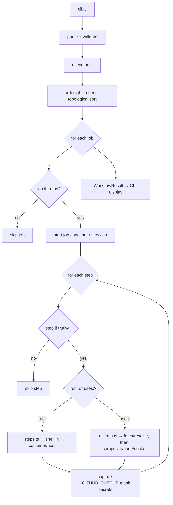

# Architecture Guide for SecureCI

How the codebase is organized, for agents and developers. For user-facing
behavior and every flag, see [DOCS.md](../../DOCS.md).

## Overview

The CLI parses GitHub Actions workflow/action YAML, validates it (optionally
against a pipeline contract), and runs it locally — jobs in `needs:` order,
matrix combinations (concurrently, up to `--parallel`), reusable workflows, and composite / JavaScript / Docker
actions, each job isolated in a container by default.

Layering is one-directional: **CLI → parser → runner → utils**.

```
CLI (cli.ts)
  → parser/   parse + validate YAML, check contracts
  → runner/   execute workflows, jobs, steps, actions
  → utils/    logging (with secret masking), key=value parsing, repo root
```

## Directory map

```
src/
├── cli.ts                 # Entry point: commander commands (run, validate, inventory, pin, init, list, config, cache)
├── config.ts              # ~/.secureci/config.yml defaults
├── report.ts              # --format text/json/sarif rendering
├── inventory.ts           # Action inventory + lockfile drift
├── github-lockfile.ts     # Read GitHub's .github/workflows/actions.lock
├── contract-source.ts     # --contract from a path or owner/repo/path@ref
├── pin.ts                 # `secureci pin`: rewrite uses: tags to commit SHAs in place
├── advisories.ts          # GitHub Advisory Database lookups, version ranges, cache
├── init.ts                # `secureci init workflow` generator
├── index.ts               # Library exports
├── version.ts             # --version: embedded at bundle time, else package.json
├── parser/
│   ├── workflow-parser.ts            # Parse workflow AND action YAML (parseFile)
│   ├── validator.ts                  # Syntax validation + expression checks
│   ├── injection.ts                  # Template injection: untrusted ${{ }} in run:/github-script (recursive)
│   ├── permissions.ts                # GITHUB_TOKEN permissions checks (default + contract policy)
│   ├── dangerous-triggers.ts         # pull_request_target/workflow_run + untrusted checkout
│   ├── allow-comments.ts             # `# secureci-allow <rule>: <reason>` comments on steps
│   ├── pipeline-contract-parser.ts   # Parse --contract files
│   └── pipeline-contract-validator.ts# Check a workflow against a contract (recursive)
├── runner/
│   ├── dry-run.ts         # Dry-run mode
│   ├── executor.ts        # Entry point: jobs in needs: order, matrix, reusable workflows
│   ├── job-plan.ts        # Matrix expansion + needs: topological sort (pure)
│   ├── scheduler.ts       # --parallel slots, job graph, matrix max-parallel/fail-fast (pure)
│   ├── github-context.ts  # github context, event payload, typed inputs
│   ├── job-runtime.ts     # Per-job state (JobRuntime), step files, post steps
│   ├── job-container.ts   # Job container, runs-on→image mapping, services, cleanup
│   ├── steps.ts           # run: steps (host or job container)
│   ├── actions.ts         # uses: dispatch, composite actions, built-ins, job-start pre
│   ├── node-action.ts     # JavaScript actions (pre/main/post)
│   ├── node-binary.ts     # Which node runs JS actions on the host (SEA-aware)
│   ├── docker-action.ts   # Docker actions and docker:// steps
│   ├── checkout.ts        # actions/checkout from the local working copy
│   ├── builtin-actions.ts # Local upload/download-artifact and cache
│   ├── expression.ts      # ${{ ... }} evaluation + if: validation
│   ├── hash-files.ts      # hashFiles() and glob matching
│   ├── runner-env.ts      # GITHUB_*/RUNNER_* env, file + workflow commands
│   ├── shell.ts           # shell: handling, argument splitting
│   ├── container-runtime.ts# Docker/Podman/containerd (nerdctl) CLI driver
│   └── action-fetcher.ts  # Fetch + cache remote actions by commit SHA
├── utils/
│   ├── logger.ts          # Logging with secret masking, withJob() prefixes
│   ├── progress.ts        # Progress lines on stderr (inventory)
│   ├── ansi.ts            # Minimal terminal colours (no chalk)
│   ├── key-value.ts       # --input/--secret/--env/--var parsing
│   ├── env-file.ts        # --env-file/--secret-file/... parsing and precedence
│   └── repository.ts      # Repository root for ./ references
└── types/index.ts         # Shared TypeScript types
```

## Standalone binary (`scripts/`)

Release binaries are Node.js single executable applications (SEA), built by
`npm run build:sea` (`scripts/build-sea.mjs`) on each platform in CI:

- `scripts/bundle.mjs` inlines `dist/` and its dependencies into one CommonJS
  file (a SEA's `require` only loads built-ins). It is a deliberately small,
  dependency-free bundler that fails the build on any `require()` it can't
  resolve statically, and defines `__SECURECI_VERSION__` (read by
  `version.ts`, since package.json isn't on disk next to a binary).
- `build-sea.mjs` makes the SEA blob, injects it into a copy of the running
  `node` with `postject`, and ad-hoc signs it on macOS.
- Inside a SEA `process.execPath` is the CLI itself, so `node-binary.ts` runs
  JavaScript actions on the host with the first `node` on the step's `PATH`
  instead. Job containers always use the image's own `node`.

## Layers

### CLI (`cli.ts`)

Defines the commander commands and routes to handlers. User-facing error display
and exit codes live here. Keep command wiring thin; put logic in the layer below.

### Parser (`parser/`)

- `workflow-parser.ts` — `parseFile()` reads YAML and returns a typed workflow or
  action.
- `validator.ts` — `validateWorkflow()` / `validateAction()` return a
  `ValidationResult`; also runs expression/`if:` checks
  (`workflowExpressionErrors`, `actionExpressionErrors`) and the template
  injection check from `injection.ts`, which uses `expressionDataFlow()` in
  `runner/expression.ts` to see which contexts reach a `run:` script.
- `permissions.ts` — GITHUB_TOKEN `permissions:` checks: default warnings
  (run by `validateWorkflow`) and the contract `permissions:` policy (errors,
  run by the contract validator). `mergeValidationResults` drops a warning an
  error with the same rule and path supersedes.
- `dangerous-triggers.ts` — `pull_request_target` / `workflow_run` jobs that
  check out untrusted code and then run it (errors, whose message says whether
  `actions/checkout`'s safe default or `allow-unsafe-pr-checkout` applies), and
  the privileged trigger alone (a warning); the contract's `forbidden-triggers`
  is checked by the contract validator.
- `allow-comments.ts` — reads `# secureci-allow <rule>: <reason>` comments on
  (or directly above) a step from the YAML source, since the parsed workflow
  drops comments. `validateWorkflow` passes them to `dangerousTriggerErrors`,
  which downgrades that step's finding to a warning quoting the reason.
- Advisory findings (`secureci/vulnerable-action`) come from `advisories.ts`,
  which `cli.ts` runs for `validate` and `inventory`; the parser stays offline.
- `pipeline-contract-{parser,validator}.ts` — parse a `--contract` file and check
  a workflow against it, recursing into local (and, opt-in, remote) composite
  actions and reusable workflows.

### Runner (`runner/`)

`executor.ts` is the entry point and re-exports the public API. Execution is split
by concern:

- **Planning:** `job-plan.ts` (matrix expansion, `needs:` topological sort — pure
  and unit-tested in isolation) and `scheduler.ts` (concurrency: the global
  `--parallel` slots, starting a job once its `needs:` are done, matrix
  `max-parallel` and `fail-fast` cancellation via `AbortSignal` — tested with
  fake jobs). Concurrent jobs' log lines are told apart by the logger's
  `withJob()` prefix (`AsyncLocalStorage`).
- **Context:** `github-context.ts` (the `github` context, event payload, typed
  inputs).
- **Per-job:** `job-runtime.ts` (state, step files, post steps) and
  `job-container.ts` (the container, `runs-on`→image mapping, services, cleanup).
- **Per-step:** `steps.ts` (`run:`), `actions.ts` (`uses:` dispatch + composite +
  built-ins), with `node-action.ts` and `docker-action.ts` for the other action
  types. `checkout.ts` and `builtin-actions.ts` are local stand-ins for
  `actions/checkout`, artifacts and cache.
- **Support:** `expression.ts`, `hash-files.ts`, `runner-env.ts`, `shell.ts`,
  `container-runtime.ts`, `action-fetcher.ts`.

`steps.ts` and `actions.ts` import each other (composite actions run steps); every
other dependency points one way.

### Utils (`utils/`)

`logger.ts` is the **secret-masking** logger — use it, not `console`, so masked
values stay redacted. `key-value.ts` parses the `--input/--secret/--env/--var`
flags; `env-file.ts` parses their `.env`-style file counterparts
(`--env-file` etc.) and merges config defaults, files and flags in precedence
order; `repository.ts` finds the repo root for `./` references.

## Execution flow



## Conventions that matter here

- **Secrets** are masked across all `logger` output and, in container mode, never
  appear on the container client's command line (passed via a `0600` env file).
- **No silent host fallback.** If the container runtime is unavailable the run
  exits; running on the host requires the explicit `--container-runtime host`
  opt-in.
- **Runner fidelity is the spec.** Where behavior emulates GitHub Actions, "what
  the real runner does" is the reference — cite it in tests and comments when it
  isn't obvious.
- **Type safety:** explicit return types on exported functions; avoid `any`;
  model variants with union types.

## Where to add things

- **New CLI command:** define it in `cli.ts`, keep logic in a dedicated module.
- **New validation rule:** `validator.ts` (+ `validator.test.ts`), or its own
  `parser/<rule>.ts` called from `validateWorkflow`. Give findings a `rule` id
  and declare it in `RULES` in `report.ts` so SARIF and JSON carry it, and
  document it in DOCS.md.
- **New action type:** extend `ActionRuns` in `types/index.ts`, dispatch in
  `actions.ts` (or a new `<type>-action.ts`), add fixtures + tests.
- **New workflow feature:** update `types/index.ts`, the parser, the validator,
  and the executor as needed — test-first.

Keep layers distinct, add/adjust types in `types/index.ts`, and maintain the
coverage thresholds in `vitest.config.mts`. See [TESTING.md](TESTING.md).

## Summary for agents

Layered CLI → parser → runner → utils · runner split by concern with `executor.ts`
as the entry point · secret-masking logger everywhere · container-isolated by
default, no silent host fallback · runner fidelity is the spec · TDD.
